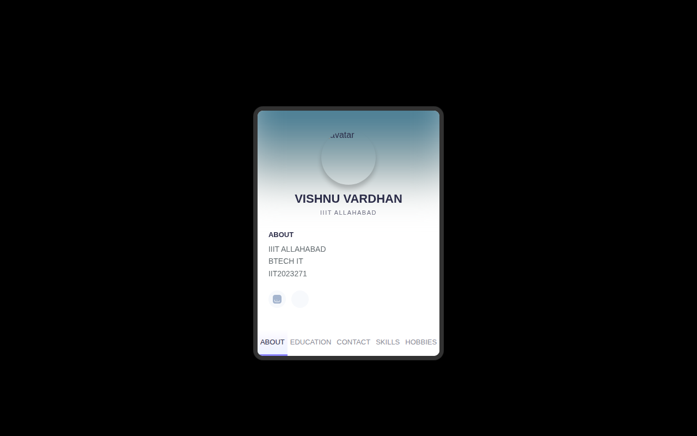

# Portfolio Card

A tabbed personal portfolio card site for Vishnu Vardhan (IIIT Allahabad).



## What it is

A single-page portfolio presented as a card with tabbed sections. Click a tab to switch between About, Experience, Skills, Hobbies, and Contact — all without leaving the page.

## Features

- Tabbed card layout: About, Experience, Skills, Hobbies, Contact.
- Social links (Instagram, LinkedIn).
- Clean card UI with a profile header.

## Tech Stack

- HTML
- CSS
- JavaScript (tab switching)

## How to Run

No install, no build step — just open the entry file in a browser:

```bash
# Option 1: open directly
open portfolio.html

# Option 2: serve it locally
python3 -m http.server 8000
# then visit http://localhost:8000/portfolio.html
```

## Notes

- The entry file is `portfolio.html` (not `index.html`), so when hosting on GitHub Pages, open the `/portfolio.html` path directly.
